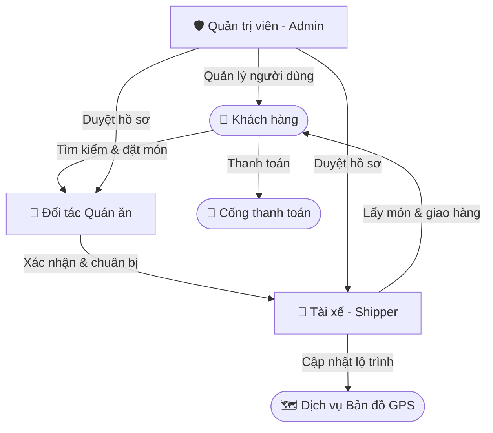
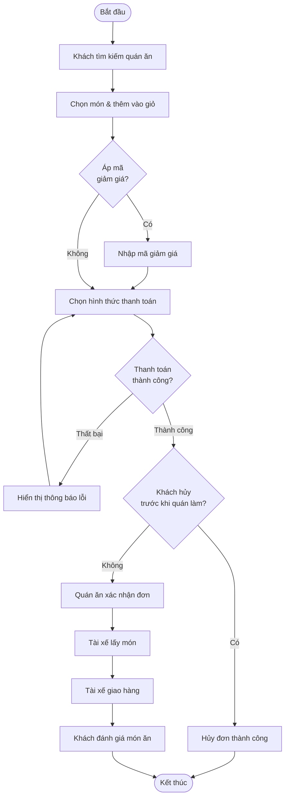

# Bối cảnh nghiệp vụ – FoodFast App

> Mô hình ứng dụng siêu kết nối kinh tế chia sẻ (O2O - Online to Offline)  
> tương tự GrabFood / ShopeeFood.

---

## 1. Sơ đồ quan hệ Actor

---

## 2. Luồng đặt món – Activity Diagram

---

## 3. Mô tả vai trò

### 👤 Khách hàng
- Tìm kiếm quán ăn / món ăn, chọn món vào giỏ
- Áp mã giảm giá *(tùy chọn)*
- Thanh toán: tiền mặt COD hoặc ví điện tử qua **Cổng thanh toán**
- Theo dõi lộ trình tài xế thời gian thực qua **Dịch vụ Bản đồ GPS**
- Hủy đơn *(nếu quán chưa bắt đầu làm món)*
- Đánh giá món ăn sau khi nhận

### 🍜 Đối tác Quán ăn
- Quản lý menu *(bật/tắt món hết hàng)*
- Tiếp nhận & xác nhận đơn đặt
- Thông báo sẵn sàng bàn giao cho tài xế

### 🛵 Tài xế (Shipper)
- Bật / tắt trạng thái nhận cuộc
- Tiếp nhận đề xuất đơn giao hàng
- Cập nhật trạng thái: `đã lấy món` → `đang giao` → `đã giao thành công`
- Xem thống kê thu nhập

### 🛡️ Quản trị viên (Admin)
- Quản lý người dùng
- Duyệt hồ sơ quán / tài xế mới
- Xử lý khiếu nại tranh chấp

### 🔗 Điểm chung (3 vai trò)
- **Đăng nhập**
- **Quản lý hồ sơ cá nhân**
- **Xem thông báo**

---

## 4. Thách thức tư duy thiết kế

**1. Kế thừa Actor**  
Làm sao để gom các thao tác chung *(Đăng nhập, Quản lý hồ sơ)* của 3 vai trò mà không bị rối đường nối?

**2. Hệ thống bên ngoài**  
Đặt Cổng thanh toán và Dịch vụ Bản đồ ở đâu, liên kết với use case nào?

**3. Phân biệt Include vs Extend**
- Áp mã giảm giá → `include` hay `extend`?
- Định vị GPS khi theo dõi đơn → `include` hay `extend`?
- Hủy đơn hàng → là gì?

**4. Generalization của Use Case**  
Ca sử dụng *"Thanh toán đơn hàng"* có thể chuyên biệt hóa thành những hình thức nào?

---

> **Đặc thù nghiệp vụ:** Một đơn hàng được phối hợp luân chuyển giữa 3 bên:  
> Khách đặt → Quán làm → Shipper giao  
>
> **Mục tiêu:** Biểu diễn chính xác sự cộng tác mà không nhầm lẫn sang Sequence Diagram.